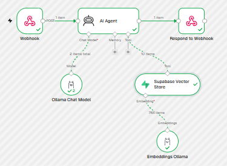

# AI Siding Receptionist – Voice Agent

A voice-based AI receptionist for a siding installation company built with **ElevenLabs, n8n, and Supabase**. It answers questions about siding products and services by retrieving relevant information from a knowledge base.

This is a shorter voice-based version of my [AI Chat Agent](https://github.com/alerika2018/n8n-ai-chat-agent), reusing the same knowledge-retrieval concept with a conversational voice interface.

### Technologies
- ElevenLabs – Voice AI agent
- n8n – Workflow automation and AI agent orchestration
- Ollama – Local LLM integration
- Qwen 2.5 and Llama 3.2 – Language models
- Supabase / PostgreSQL – Knowledge base and data retrieval
- Vector Search – Context retrieval
- ngrok – Local webhook exposure

### Demo

### Workflow

